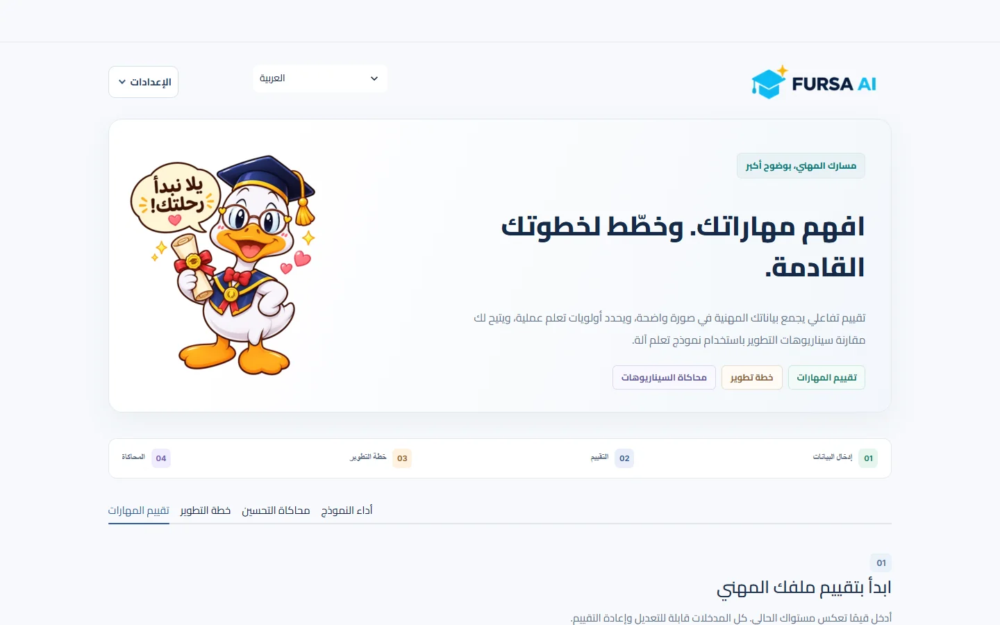
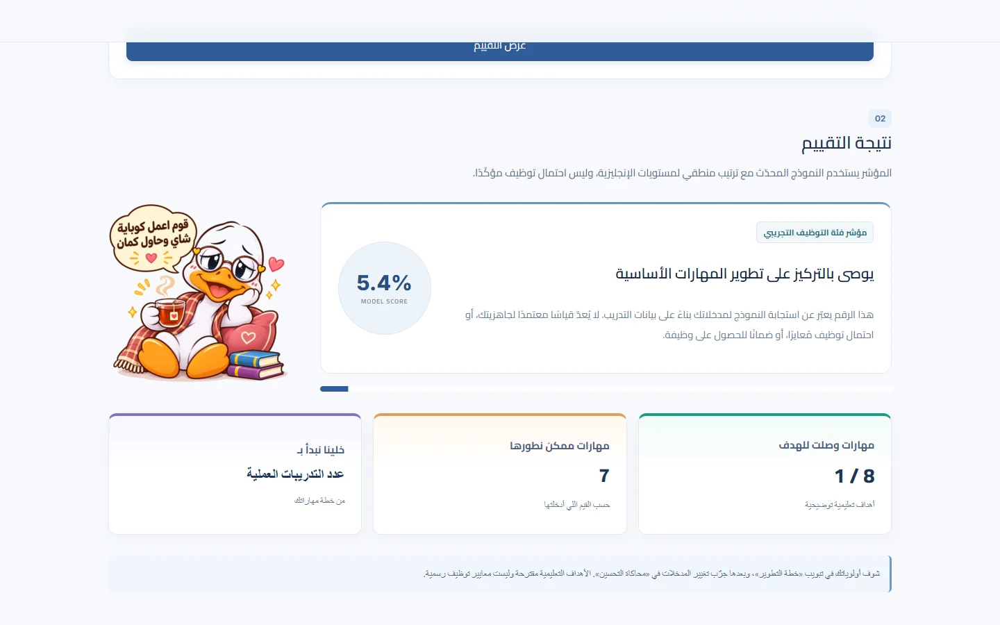
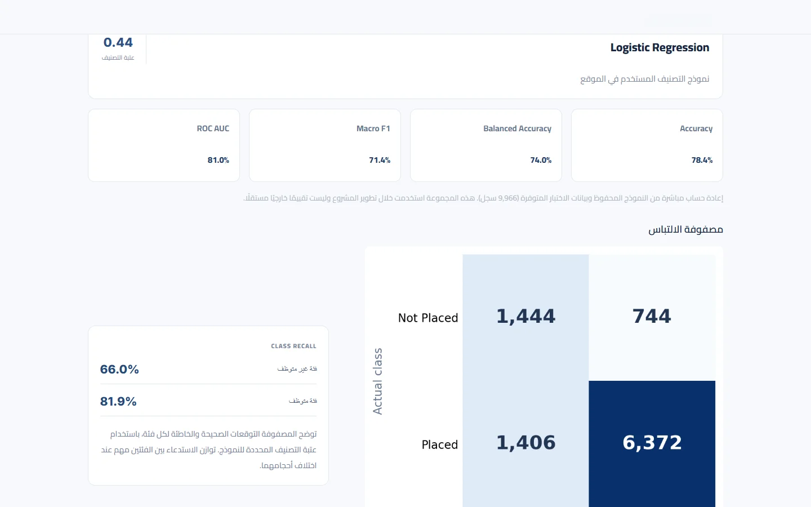

<p align="center">
  
</p>

<h1 align="center">فرصة AI — FURSA AI</h1>

<p align="center"><strong>افهم مهاراتك، وخطّط لفرصتك القادمة.</strong></p>

<p align="center">منصة تفاعلية لاستكشاف المهارات المهنية، وتحديد أولويات التطوير، وتجربة سيناريوهات تحسين افتراضية باستخدام تعلم الآلة.</p>

<p align="center">
  <a href="README.md">English README</a> ·
  <a href="#تشغيل-المشروع">تشغيل المشروع</a> ·
  <a href="#نتائج-النموذج">نتائج النموذج</a>
</p>

---

## فكرة المشروع

**فرصة AI** مشروع جامعي في الذكاء الاصطناعي وعلوم البيانات يهدف إلى مساعدة الطلاب والخريجين على فهم الجوانب التي يمكنهم تطويرها استعدادًا لسوق العمل.

بدل الاكتفاء بنتيجة تصنيف واحدة، يجمع التطبيق بين **تحليل الملف المهني، وتحديد نقاط القوة، وخطة تطوير عملية، ومحاكاة سيناريوهات التعلم** ضمن واجهة عربية وإنجليزية.

> **تنبيه:** هذا نموذج تعليمي لاستكشاف البيانات، وليس أداة موثوقة لاتخاذ قرارات التوظيف. المؤشر المعروض ليس احتمالًا معايرًا للحصول على وظيفة، ولا ضمانًا للتوظيف.

## معاينة الموقع

<p align="center">
  
</p>

<details>
<summary><strong>شاهد شاشة التقييم ولوحة تحليل النموذج</strong></summary>

### نتيجة التقييم



### تقييم النموذج



</details>

## ماذا يقدم الموقع؟

| الميزة | التفاصيل |
| --- | --- |
| **تقييم الملف** | إدخال 10 معلومات عن الدراسة والمهارات والمشاريع والتدريب والخبرات. |
| **مؤشر تعلم الآلة** | عرض خرج النموذج المدرب مع توضيح حدوده العلمية. |
| **نقاط القوة ومجالات التطوير** | مقارنة البيانات المدخلة بأهداف تعليمية تقريبية واضحة. |
| **خطة تطوير شخصية** | خطوات مقترحة، وفكرة لمشروع Portfolio، ومتابعة التقدم حتى إكمال الخطة. |
| **المحاكاة التفاعلية** | تجربة تغيير عدد المشاريع أو التدريبات أو مهارة البرمجة وملاحظة استجابة النموذج. |
| **تقييم النموذج** | مقاييس التصنيف ومصفوفة الالتباس ومخططات التدريب ومقارنة الخوارزميات. |
| **لغتان** | واجهة متجاوبة بالعربية والإنجليزية، مع شخصية بطوط لتشجيع المستخدم. |

اختيار **المجال المهني** يساعد على تخصيص فكرة المشروع المقترحة، لكنه لا يدخل في حساب توقع النموذج.

## نتائج النموذج

يعتمد التطبيق على **Logistic Regression**، مع التركيز على **Balanced Accuracy** أثناء مقارنة النماذج. أُعيد ملاءمة النموذج على بيانات التدريب المحفوظة مع قيد موثق يحافظ على ترتيب مستويات الإنجليزية، بحيث لا يخفض رفع المستوى من **أساسي ← متوسط ← متقدم** المؤشر عند ثبات باقي المعلومات.

| المقياس | النموذج المحدّث |
| --- | ---: |
| Accuracy | **78.43%** |
| Balanced Accuracy | **73.96%** |
| Macro F1 | **71.44%** |
| ROC AUC | **80.98%** |

المقاييس محسوبة على **9,966 سجلًا** من مجموعة الاختبار المحفوظة، باستخدام عتبة تصنيف **0.44**. التفاصيل موجودة في [`english_monotonicity_audit.json`](english_monotonicity_audit.json).

**مهم:** تمت مراجعة مجموعة الاختبار أثناء التطوير؛ لذلك هذه النتائج لا تمثل تحققًا خارجيًا مستقلًا. وقيد الإنجليزية افتراض تصميمي موثّق، وليس دليلًا على أن تحسين اللغة يسبب التوظيف.

للاطلاع على التدريب والتحليل: [ملف Jupyter](Fursa_AI_Balanced.ipynb) · [مقارنة الخوارزميات](model_comparison.csv) · [مخرجات التجربة](milestone3_outputs/).

## تشغيل المشروع

### المتطلبات

- Python 3.12
- Git
- الاتصال بالإنترنت لتثبيت المكتبات أول مرة

### التثبيت

```bash
git clone https://github.com/Ramaalodat/Fursa_AI_Balanced.git
cd Fursa_AI_Balanced
python -m pip install -r requirements.txt
```

### تشغيل الموقع

```bash
python -m streamlit run app.py --server.port 8502
```

ثم افتح **http://localhost:8502**. تعمل الواجهة باستخدام ملفات النموذج والمعالجة المحفوظة، **ولا يلزم إعادة التدريب** لتشغيل الموقع.

> رابط `localhost` يعمل على جهازك محليًا، وليس رابط نشر عام.

## أهم الملفات

```text
app.py                         موقع Streamlit
model_report.py                حساب مقاييس أداء النموذج
train_monotonic_english.py     إعادة تدريب النموذج بقيد الإنجليزية
english_monotonicity_audit.json نتائج المقارنة والتوثيق
Fursa_AI_Balanced.ipynb        التجارب والتدريب
milestone3_outputs/            النماذج والبيانات والرسوم المحفوظة
assets/                        الشعار وصور بطوط وملفات التصميم
docs/images/                   لقطات حقيقية من الموقع
.streamlit/config.toml         إعدادات الموقع
requirements.txt               المكتبات
README.md                      الدليل الإنجليزي
```

## الحدود العلمية والأخلاقية

- أهداف المهارات **توضيحية وتعليمية**، وليست متطلبات توظيف رسمية أو تفسيرًا مباشرًا للنموذج.
- المحاكاة توضح **تغيّر استجابة النموذج** ولا تثبت تأثيرًا سببيًا للتدريب أو المشاريع على التوظيف.
- لم يثبت التمثيل الفعلي لبيانات المشروع لسوق العمل الأردني أو مصدرها الأصلي بشكل مستقل.
- ينبغي استخدام التقييم لتحديد أولويات التعلم، **وليس لقبول الأشخاص أو رفضهم في التوظيف**.

---

<p align="center"><strong>فرصة AI — تعلّم. تطوّر. واصنع فرصتك.</strong></p>

<p align="center">مشروع جامعي في الذكاء الاصطناعي وعلوم البيانات.</p>

<p align="center"><a href="README.md">English documentation</a></p>
